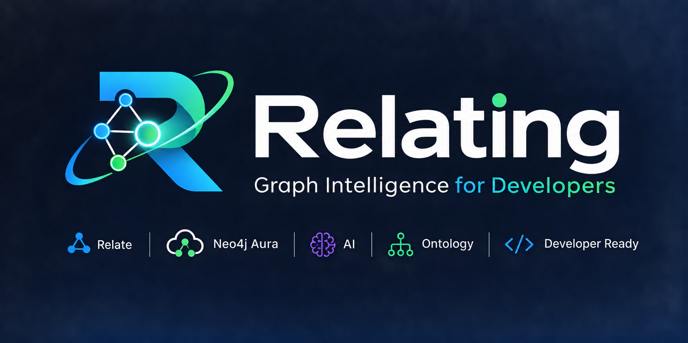
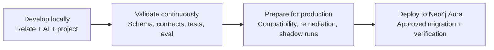
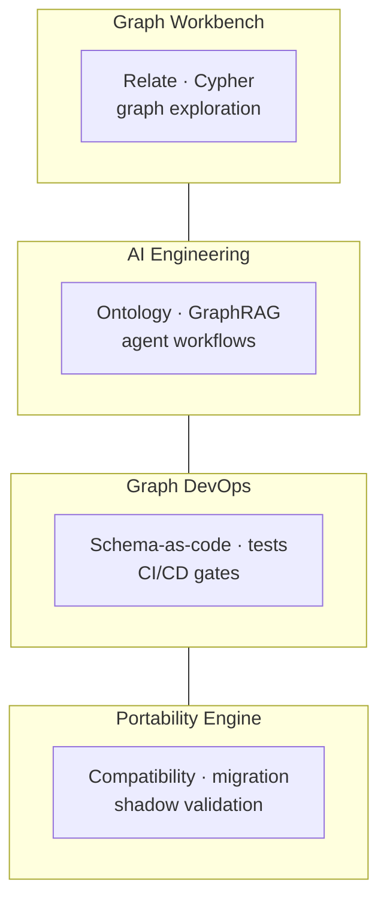
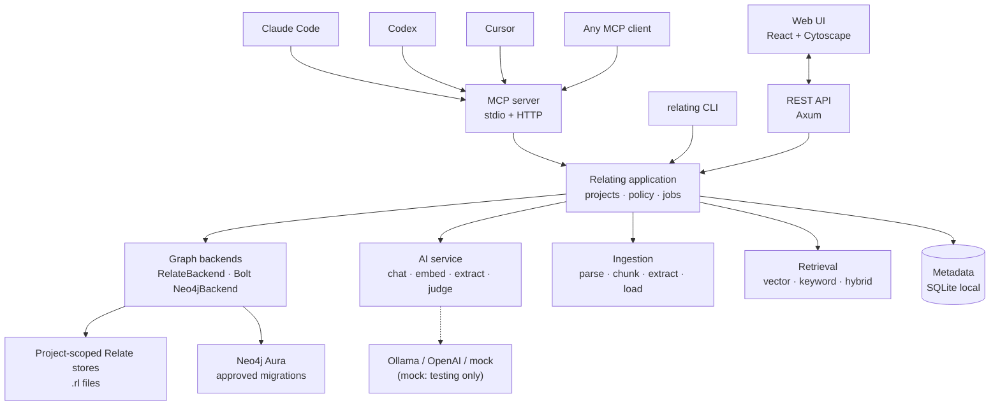
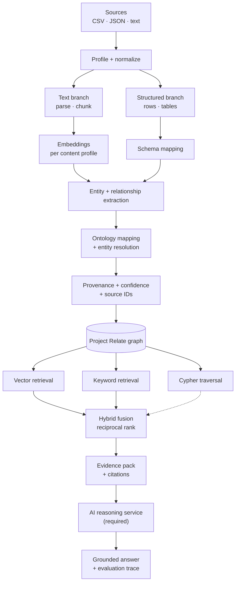
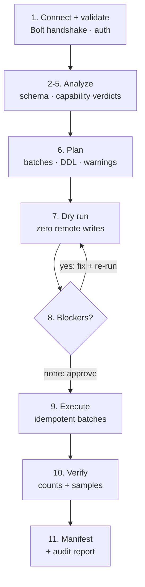

# Relating


[About the project](about_the_project.md)

> **Relate + Intelligence. Build connected knowledge. Give every agent a way to reason over it.**

Relating is a local-first, AI-native graph development and GraphRAG workbench. It combines the embedded [Relate](https://relatedb.ai/) graph database with mandatory AI services, document and structured-data ingestion, graph exploration, grounded retrieval, agent tools, and a guided migration path to Neo4j Aura.

**Product promise:** Build locally. Understand your data intelligently. Connect your agents. Deploy and migrate confidently.

> Relating is an independent product built on Relate. It is not an official Neo4j product and does not imply endorsement by Neo4j or the Relate maintainers.

---

## Quick start

Prerequisites: Rust stable (via [rustup](https://rustup.rs)) and Node.js 20+ with npm. Optional: Ollama (`ollama serve`) for local AI models.

```bash
./start.sh
```

Then open http://127.0.0.1:8080 in your browser to use the workbench.

The script builds the web UI when missing, starts the API and serves the UI from it, and keeps project data in `./data` (override with `RELATING_DATA_DIR`). Useful options: `--port 8081` to change ports, `--release` for the optimized build, `--rebuild-web` to force a UI rebuild. Alternatively: `docker compose up --build` for the full stack (server + team Postgres + local Ollama AI, each with its own `Dockerfile` under `docker/` — see [docs/docker.md](docs/docker.md)).

> The built-in mock AI provider is for **development and testing only** — it returns
> deterministic canned responses and is never production AI functionality. Configure
> Ollama, OpenAI, or another OpenAI-compatible provider for real inference.

Headless workflows use the CLI instead: `cargo run -p relating-cli -- validate --project ID`
(validations, contract tests, schema export/diff, eval gates, shadow runs, debugging —
see [docs/api/ci.md](docs/api/ci.md)).

**Status: milestones A–E and releases R1–R6 are implemented** — projects, ingestion,
ontology, graph explorer, Cypher, embeddings, retrieval, grounded Q&A, evaluation,
MCP agent server, Aura migration over Bolt, schema-as-code, portability compiler,
CI/CD gates, shadow testing, graph debugger, synthetic data, and the performance
advisor. Also implemented: Relate↔Aura backend flip without query rewrites
([backend_flip.md](docs/api/backend_flip.md)), Aura vector-index fit checks,
PDF/DOCX ingestion, merge-upsert migration disclosure, and team secrets plus
PostgreSQL provisioning ([postgres.md](docs/postgres.md), [secrets.md](docs/secrets.md)).
See [Visual overview](#visual-overview) and the [API docs](docs/api/) for
details.

---

## Visual overview

### The developer journey



### One platform, four faces



### What lives where (workbench tabs)

| Tab | Capability | Release |
|---|---|---|
| 1. Sources | CSV/JSON/text/PDF/DOCX ingest, lineage | B |
| 2. Ontology | AI proposal, approval gate | B |
| 3. Graph Explorer | Cytoscape visualization | B |
| 4. Cypher Console | Read/write workbench | A–B |
| 5. AI Service | Provider config, health | A |
| 6. Retrieval & Q&A | Embeddings, hybrid search, eval | C |
| 7. Agents | MCP connection snippets | R1 |
| 8. Aura Migration | Analyze → approve → migrate → verify | R1 |
| 9. Schema & Contracts | As-code export, revisions, diff | R2 |
| 10. Portability | Repo scan, remediation, target tests | R3 |
| 11. Shadow & Debug | Shadow runs, GraphRAG debugger | R5 |
| 12. Test Data & Advisor | Synthetic fixtures, perf advice | R6 |

Headless equivalents live in the [`relating` CLI](docs/api/ci.md) and the
[GitHub workflow](.github/workflows/relating.yml) (R4).

---

## 1. Product definition

Relating is a domain-agnostic application for individual developers and enterprise teams. A project can contain any permitted business or technical domain: software repositories, product catalogues, supply chains, research papers, enterprise knowledge, financial data, or a user's own datasets.

It is not a banking application and must not bake any single industry ontology into the platform.

### Core modules

1. **GraphRAG Development Workbench**
   - Create isolated graph projects.
   - Ingest files and structured sources.
   - Profile data and propose an editable ontology.
   - Extract entities and relationships with AI.
   - Store connected data in Relate.
   - Explore and query with Cypher.
   - Build vector, full-text, graph, and hybrid retrieval.
   - Evaluate retrieval and generated answers with traceable evidence.

2. **AI Service and Agent Integration**
   - AI is a required platform service, not a removable feature.
   - Configure one or more model providers for chat/reasoning, embeddings, extraction, reranking, and evaluation.
   - Support local and hosted inference through provider adapters.
   - Expose project-scoped tools through MCP.
   - Connect compatible clients such as Claude Code, Codex, Cursor, and other MCP clients.
   - Provide CLI and SDK access for scripts and applications.

3. **Relate-to-Neo4j Aura Migration Assistant**
   - Connect to a Neo4j/Aura destination.
   - Inspect source and target schema.
   - Analyse Cypher and feature compatibility.
   - Generate a migration plan and dry-run report.
   - Transfer approved data in resumable batches.
   - Verify counts, properties, relationships, constraints, and indexes.
   - Produce a migration manifest and audit report.

Relating must remain useful when a user never migrates to Aura.

## 2. Product principles

- **Local-first:** a developer can start with a local project and local Relate store.
- **AI-required, provider-flexible:** every workspace has an AI service configuration; providers and models are replaceable.
- **Graph-first, domain-neutral:** ontology and data model belong to each project.
- **Agent-native:** MCP, CLI, and documented APIs are first-class interfaces.
- **Safe by default:** read-only queries by default; explicit approval for writes and remote migration.
- **Portable:** project configuration, ontology, source manifests, prompts, retrieval settings, and evaluation definitions are exportable.
- **Incremental delivery:** a working vertical slice is more valuable than a broad but nonfunctional shell.
- **Upstream-first:** use Relate as a dependency; do not fork or reimplement its graph engine without a documented technical reason.

## 3. Reference architecture



Secrets are never stored: Aura passwords resolve at runtime from environment
variables, mounted secret files, or the OS keychain (see [docs/secrets.md](docs/secrets.md)),
and provider keys stay in project configuration outside version control.
(Team PostgreSQL metadata: schema provisioning and validation are available —
see [docs/postgres.md](docs/postgres.md); Vault secret backends remain roadmap.)

### Technology decisions

| Layer | Initial choice | Responsibility |
|---|---|---|
| Web UI | React + TypeScript | Workbench, project setup, graph explorer, ingestion, AI settings, migration |
| API/control plane | Rust + Axum + Tokio | Projects, jobs, policy, graph adapters, MCP orchestration |
| Graph engine | Relate Rust crate / supported Relate interfaces | Local graph storage and Cypher execution |
| AI service | Required provider abstraction | LLM, embeddings, extraction, reranking, evaluation |
| Document workers | Python initially, isolated behind job interface | PDF/DOCX/HTML parsing and AI-heavy processing |
| Metadata | SQLite local; PostgreSQL server | Users, projects, sources, jobs, configs, audit |
| Visualization | Cytoscape.js | Graph rendering and interaction |
| MCP | Official MCP SDK / protocol-compatible transport | Tools and resources for external agents |
| Packaging | Docker Compose first; Tauri optional | Reproducible local and self-hosted deployment |

Start as a **modular monolith**. Split workers into separate processes only when load, security, or deployment needs justify it.

### Graph backend abstraction

Define a stable internal interface, for example:

- `GraphBackend`
- `RelateBackend`
- `Neo4jBackend`

Keep graph data in the graph backend. Keep application metadata in SQLite/PostgreSQL. Do not treat a shared Relate store as tenant isolation: use project-scoped stores or a rigorously enforced namespace model. The default MVP should use one Relate store per project.

### AI service is mandatory

A workspace cannot become “ready” until an AI provider is configured and a health check succeeds. The AI service itself must be abstracted so providers can be changed without changing ingestion or retrieval code.

Required AI capabilities:
- Chat/reasoning model.
- Embedding model.
- Structured extraction (can use the configured reasoning model with constrained output).
- Reranking capability, with a deterministic fallback for the first MVP.
- Evaluation/judging capability, with explicit model and prompt versioning.

Local model servers and hosted APIs should be supported through adapters. Do not hard-code a vendor or model. Store model ID, provider, dimensions, modality, version, and configuration per embedding profile. Never compare vectors from incompatible embedding spaces.

If credentials or a provider are not configured, show a clear setup state and block AI-dependent operations; do not silently pretend AI ran.

## 4. Relate integration and installation

Relating should use the supported Relate Rust crate/API where practical, and the installed Relate CLI for operational workflows where appropriate. Verify the current API and version during implementation; do not assume examples from a different release remain valid.

Relate's official install guide currently documents:
- CLI installation on macOS/Linux using `curl -sSfL https://relatedb.ai/install.sh | bash`.
- Python package `relate-db`.
- Node package `@relate/relate`.
- Browser package `@relate/relate-wasm`.
- Rust crate installation through Cargo.
- A Windows binary installation path.

For local development, support a guided prerequisite check:
1. Detect OS and architecture.
2. Detect `relate` and report its version.
3. If missing, offer the official install instructions; do not run an unreviewed remote shell script automatically.
4. Verify `relate --version`.
5. Run `relate agent-context` to inspect the installed command surface.
6. Create a project-scoped store only after the user creates a project.
7. Preserve existing stores. Never overwrite, clear, or migrate a store without explicit confirmation.

Relate supports in-memory, directory, and single-file `.rl` stores. Prefer a directory store for active development and offer a single-file export when the installed version supports it and the user requests portability. Respect Relate's durability and backup guidance.

### Relate features to integrate

Use and surface supported upstream capabilities rather than rebuilding them:
- Cypher query execution and schema inspection.
- Local persistent stores and in-memory development stores.
- CSV/JSON ingestion capabilities where supported.
- Vector and full-text features supported by the installed Relate version.
- CLI and language bindings.
- HTTP/Bolt/MCP serving where available.
- Neo4j/Aura pull and push workflows where supported.
- Relate's own agent skill and `agent-context` reference.

Relating's differentiator is the higher-level workflow: multi-source ingestion, AI ontology and extraction, provenance, GraphRAG configuration, evaluation, multi-project UX, policy, migration analysis, resumability, and verification.

Do not claim feature parity with Neo4j. Maintain a versioned capability registry. Mark features as `SUPPORTED`, `RECREATE`, `TRANSFORM`, `UNSUPPORTED`, or `REQUIRES_MANUAL_REVIEW`.

## 5. MCP and external agent connectivity

MCP connectivity is a core integration target, not a mandatory dependency for the web application to function.

Relating should expose an MCP server so compatible agent hosts can connect to a user's selected project. Support:
- **stdio** for local coding agents launched on the same machine.
- **Streamable HTTP** (or the transport supported by the chosen MCP SDK) for remote/self-hosted deployments.
- Project-scoped authentication and authorization.
- Read-only tools by default.
- Separate write tools requiring explicit policy and user approval.
- Tool descriptions and JSON schemas that are stable and documented.

Initial MCP tools:
- `list_projects`
- `get_project_summary`
- `get_graph_schema`
- `search_sources`
- `search_graph`
- `read_cypher`
- `retrieve_context`
- `explain_retrieval`
- `get_ingestion_status`
- `get_evaluation_report`
- `analyze_aura_compatibility`
- `preview_migration`

Write tools, disabled unless explicitly enabled:
- `ingest_source`
- `write_cypher`
- `create_ontology_revision`
- `execute_approved_migration`

Security rules:
- Do not expose database credentials or provider API keys to the agent.
- Do not allow an MCP client to choose arbitrary project IDs outside its granted scope.
- Bound query time, result size, and resource consumption.
- Validate all tool arguments.
- Record tool calls and actor identity in audit logs.
- Require confirmation for destructive or remote write actions.
- Treat retrieved documents and graph content as untrusted data, never as tool instructions.

### Client connection experience

Provide a “Connect an agent” screen with copyable configuration examples for supported clients. Do not promise one-click installation for every client until tested. The screenshot's pattern is the target: external agent clients and developer interfaces connect to Relating, while Relating manages graph storage and access to the user's data.

## 6. MVP scope

The MVP is a working product, not a static dashboard. Prioritize a narrow end-to-end path that can be used immediately, then add capability behind stable interfaces.

### MVP acceptance path

A user must be able to:

1. Install and launch Relating locally with Docker Compose or the documented developer command.
2. Create a workspace and an isolated project.
3. Configure and test a required AI provider.
4. Create/open a project-scoped Relate store.
5. Upload CSV, JSON, PDF, and DOCX files.
6. Inspect extracted text, tables, metadata, and source lineage.
7. Generate an AI-proposed ontology and edit/approve it.
8. Extract entities and relationships and load them into Relate.
9. Explore the graph visually and inspect source provenance.
10. Run read-only Cypher queries.
11. Generate embeddings and run vector/hybrid/graph retrieval.
12. Ask a question and receive a grounded answer with source references.
13. Inspect retrieval traces and run a basic evaluation.
14. Connect an MCP client in read-only mode and use project tools.
15. Connect a Neo4j Aura destination, analyse compatibility, preview a migration, and execute only after approval.
16. Verify the destination and export a migration report.

### Scope priorities

**P0 — must work**
- Local project lifecycle and isolation.
- AI provider setup and health check.
- Relate integration and Cypher.
- CSV/JSON/PDF/DOCX ingestion.
- AI-assisted ontology proposal and approval.
- Entity/relation extraction with provenance.
- Graph visualization and schema view.
- Text embeddings and hybrid retrieval.
- Grounded Q&A with citations.
- Basic evaluation and traces.
- MCP read-only server.
- Aura connection, compatibility analysis, dry run, approved migration, verification.
- Docker Compose and documented local setup.

**P1 — next**
- CLI.
- MCP write tools with policy approvals.
- SQL and REST connectors.
- Incremental ingestion and change detection.
- Team workspaces, OIDC, RBAC, audit exports.
- Advanced reranking and retrieval evaluation.
- Tauri desktop packaging.
- Kubernetes deployment.

Do not implement every connector, every agent client, or a microservice fleet before the P0 acceptance path works.

## 7. GraphRAG data pipeline



### Multi-embedding design

Allow different embedding profiles for different content types (for example prose, tables, code, and images). Store:
- `embedding_profile_id`
- provider and model ID/version
- dimensions
- modality/content type
- source and chunk/table/row identity
- source version and content hash
- embedding timestamp

Use separate vector indexes/spaces per compatible profile. Filter retrieval by profile and dimensions; never calculate similarity across unrelated vector spaces. Preserve the original table structure and cell/row provenance rather than flattening every table into prose.

## 8. Aura migration workflow



1. Create and validate a destination connection.
2. Inspect source graph schema and target database capabilities.
3. Capture a consistent source snapshot or define the supported consistency boundary.
4. Analyse labels, relationship types, property types, constraints, indexes, and Cypher usage.
5. Classify each issue using the capability registry.
6. Produce a plan with counts, transformations, warnings, and estimated batches.
7. Execute a dry run with no remote mutation.
8. Require explicit approval.
9. Transfer in idempotent, resumable batches using stable business keys where possible.
10. Verify nodes, relationships, properties, constraints, and indexes.
11. Produce a signed or integrity-checked migration manifest and audit report.

Relate's existing Neo4j/Aura pull/push capabilities can be used where appropriate. Validate their exact semantics against the installed Relate version. In particular, do not assume that indexes, constraints, vector metadata, or all Neo4j features are transferred automatically. Never claim that a push is a destructive mirror unless the upstream implementation explicitly guarantees that behavior.

Incremental synchronization is not automatically real-time replication. It requires change tracking, stable identities, conflict handling, and reconciliation. Treat it as P1 unless those semantics are implemented and tested.

## 9. Security and enterprise requirements

- Local secrets in OS keychain where available.
- Server secrets through Vault/KMS or encrypted secret storage.
- TLS for remote interfaces.
- OIDC and RBAC for team deployments.
- Project-level data isolation.
- Read-only defaults for Cypher and MCP.
- Explicit confirmation for graph writes and Aura migration.
- Query timeout, result limits, rate limits, and upload limits.
- Audit events for access, model calls, ingestion, graph writes, and migrations.
- No third-party model transmission without provider configuration and user/admin consent.
- Configurable retention and deletion policies.
- Dependency, container, and license scanning.
- No secrets in logs, prompts, traces, or exported manifests.

## 10. Suggested repository layout

Start with a small number of crates and modules. Expand only when boundaries are justified.

```text
relating/
├── web/                     # React + TypeScript workbench (12 tabs)
├── crates/
│   ├── relating-core/       # domain types and orchestration
│   ├── relating-server/     # Axum REST API + binaries
│   ├── relating-graph/      # GraphBackend + Relate adapter
│   ├── relating-ai/         # provider abstraction (mock/openai/ollama)
│   ├── relating-ingest/     # source pipeline (CSV/JSON/text)
│   ├── relating-retrieval/  # chunking, hybrid retrieval, Q&A, eval
│   ├── relating-mcp/        # MCP tools + stdio/HTTP transports
│   ├── relating-migrate/    # Bolt client, Aura analysis/plan/execute/verify
│   ├── relating-schema/     # schema-as-code docs, diff, conformance
│   ├── relating-portability/# repo scanner, rules, remediation, tests
│   ├── relating-cli/        # relating CLI (validate, gates, schema, eval)
│   ├── relating-shadow/     # dual-backend replay + comparison
│   ├── relating-debug/      # GraphRAG traces + diagnosis
│   ├── relating-synth/      # synthetic fixture generation
│   └── relating-advisor/    # perf/cost rules, sizing, measurements
├── docs/api/                # per-area API contracts
├── .github/workflows/       # relating.yml CI gates
├── start.sh                 # one-command local start
├── docker/                  # one folder + Dockerfile per compose service
│   ├── server/              # API + workbench UI + MCP (also used by db-init)
│   ├── postgres/            # team Postgres 17
│   ├── ollama/              # local AI backend with model preload
│   └── neo4j/               # opt-in local Bolt target (--profile neo4j)
├── Cargo.toml
├── README.md
├── SKILL.md
├── .env.example
└── docker-compose.yml
```

## 11. Delivery strategy: fastest route to a working MVP

Do not plan this as a months-long architecture exercise. Build a thin vertical slice and keep the scope controlled.

### Milestone A — runnable skeleton ✅
- Monorepo, Rust workspace, React app.
- Axum health/API endpoint.
- SQLite metadata.
- Relate dependency and a project-scoped store.
- Docker Compose.
- AI provider interface and configuration screen.
- One working provider adapter and health check.

### Milestone B — first useful graph ✅
- CSV/JSON ingestion.
- AI ontology proposal and approval.
- Entity/relation extraction.
- Load into Relate.
- Schema and graph explorer.
- Read-only Cypher console.

### Milestone C — first GraphRAG answer ✅ (text, PDF, and DOCX sources)
- Chunking and embedding.
- Vector/keyword/hybrid retrieval.
- Grounded Q&A with source citations.
- Trace and basic evaluation.

### Milestone D — agent connection ✅
- MCP read-only tools.
- stdio local connection.
- HTTP connection for self-hosted deployment.
- Client configuration snippets and connection test.

### Milestone E — Aura migration ✅
- Aura connection management.
- Schema and compatibility inspection.
- Dry-run plan.
- Approved batch transfer.
- Verification and report.

### Releases R1–R6 ✅
- R1: MCP server + Aura connection and migration.
- R2: Graph schema-as-code + versioning.
- R3: Graph Portability Compiler.
- R4: Graph CI/CD + GitHub Actions.
- R5: Shadow testing + AI Graph Debugger.
- R6: Synthetic graph data + performance advisor.

A milestone is complete only when its acceptance tests pass.

## 12. Engineering rules

1. Keep `main` runnable.
2. Write a short ADR before changing a core architecture decision.
3. Add integration tests around Relate and Aura adapters.
4. Use parameterized Cypher values; never interpolate user values into query strings.
5. Inspect schema before generating Cypher.
6. Use read-only mode unless the user explicitly requests a write.
7. Bound non-aggregate query results.
8. Make ingestion and migration jobs restartable and idempotent.
9. Store model/provider/version metadata with every AI-derived artifact.
10. Preserve provenance for every extracted node, relationship, chunk, and answer citation.
11. Never fabricate an AI result when a provider call fails.
12. Keep secrets out of browser storage, logs, and MCP payloads.
13. Do not fork Relate for convenience; isolate upstream-specific behavior in its adapter.
14. Keep the simplest implementation that passes the acceptance criteria.

## 13. Definition of done

The MVP is done when a fresh developer can follow the README, launch Relating, configure AI, create a project, ingest a sample dataset, inspect the generated graph, ask a grounded question, connect one MCP client, and complete a dry-run plus approved Aura migration with verification.

Performance numbers should be measured and reported, not invented as guarantees. Establish baseline benchmarks for ingestion throughput, graph query latency, retrieval latency, memory usage, and migration throughput on documented hardware.

## 14. Official technical references

- Relate installation: https://relatedb.ai/docs/get-started/install/
- Relate documentation: https://relatedb.ai/docs/
- Relate API surfaces: https://relatedb.ai/docs/reference/api/
- Relate CLI: https://relatedb.ai/docs/reference/cli/
- Agent quickstart: https://relatedb.ai/docs/get-started/agent-quickstart/
- Relate GitHub: https://github.com/relatedb/relate
- Neo4j Aura documentation: https://neo4j.com/docs/aura/

Always verify commands, APIs, package versions, and supported capabilities against the installed Relate release. Documentation pages and model-generated examples are references, not executable instructions.
